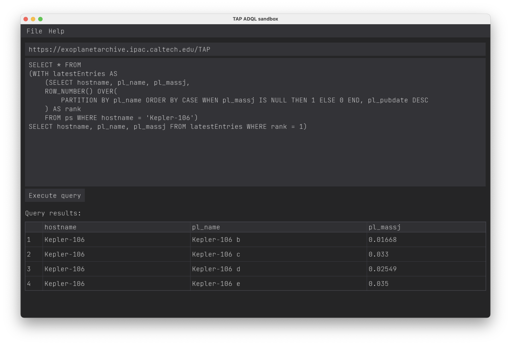

# TAP ADQL sandbox

<!-- MarkdownTOC -->

- [About](#about)
    - [Demonstration](#demonstration)
- [Installing](#installing)
    - [From PyPI](#from-pypi)
    - [From sources](#from-sources)
- [Running](#running)
- [Platforms](#platforms)
- [Known problems](#known-problems)
    - [Installation fails on a too new Python version](#installation-fails-on-a-too-new-python-version)
    - [Application tries to connect to remote hosts on startup and sometimes crashes](#application-tries-to-connect-to-remote-hosts-on-startup-and-sometimes-crashes)
    - [Queries might fail with UnicodeDecodeError](#queries-might-fail-with-unicodedecodeerror)
- [3rd-party](#3rd-party)
    - [Dependencies](#dependencies)
    - [Resources](#resources)

<!-- /MarkdownTOC -->

## About

A sandbox application for executing ADQL queries via TAP interface of various data sources, such as astronomical databases. Essentially, it's just a GUI for [PyVO](https://pypi.org/project/pyvo/).



More details in [this article](https://decovar.dev/blog/2022/02/26/astronomy-databases-tap-adql/).

### Demonstration

https://user-images.githubusercontent.com/6904927/154367260-db2dc02c-ee88-4fe2-b500-cae14d51bd08.mp4

## Installing

### From PyPI

``` sh
$ pip install tap-adql-sandbox
```

### From sources

``` sh
$ cd /path/to/repository/
$ pip install ./
```

or:

``` sh
$ cd /path/to/repository/
$ python -m build
$ pip install ./dist/tap_adql_sandbox-VERSION-py3-none-any.whl
```

## Running

``` sh
$ tap-adql-sandbox --help
```

## Platforms

Tested on all the major desktop operating systems (*Mac OS, Windows, GNU/Linux*), but latest versions of the application require Dear PyGui `2.3` or later, which is published only for these platforms:

- Mac OS 13 or newer, ARM64 (*Apple silicon*) only;
- Windows 10/11, x64 only;
- GNU/Linux, both x64 and ARM64.

which unfortunately applies the same restriction on the application itself.

Previous releases also supported x64 on older Mac OS, so if you need that, then you can try installing [0.8.2](https://pypi.org/project/tap-adql-sandbox/0.8.2/) release.

## Known problems

### Installation fails on a too new Python version

Some dependencies such as Dear PyGui are published only as pre-built wheels (*with no source package to build from*), and wheels for latest Python versions might appear only after some time. Until then, installing this application into an environment such a Python version may fail:

``` sh
ERROR: Could not find a version that satisfies the requirement dearpygui>=1.5.0 (from versions: none)
ERROR: No matching distribution found for dearpygui>=1.5.0
```

or, with `uv pip install`:

``` sh
hint: You require CPython 3.15 (`cp315`), but we only found wheels for `dearpygui` (v2.3.1) with the following Python ABI tags: `cp38`, `cp39`, `cp310`, `cp311`, `cp312`, `cp313`, `cp314`
```

So until Dear PyGui release with wheels for your Python version becomes available, use an environment with an older Python version.

### Application tries to connect to remote hosts on startup and sometimes crashes

Sometimes when you are just launching the application, so you didn't even have a chance to execute any queries, you might notice that it tries to reach various remote hosts on the internet, such as `obspm.fr`, `ietf.org` or probably others.

This is because of the [Astropy](https://astropy.org) package, which is an indirect dependency through PyVO, which is a direct dependency of this project. Specifically, it's the hosts listed in [this file](https://github.com/astropy/astropy/blob/main/astropy/utils/iers/iers.py). Looks harmless enough, apparently just updating some astronomical data.

Denying access to these hosts might lead to the application crash, because Astropy doesn't handle such situation properly:

```
AttributeError: module 'IPython.utils.io' has no attribute 'stdout'
```

If you get the application crashing even when access to those is allowed, try to update the Astropy (*and probably also PyVO*) package:

``` sh
$ pip install astropy -U
```

I had this problem with Astropy v4.2, and it was gone after updating to Astropy v5.1. Or perhaps the problem isn't really gone, but the new package version just came with updated data, so for now there is no need for updating.

### Queries might fail with UnicodeDecodeError

If query results from a TAP service contain non-ASCII symbols, then PyVO will raise [an exception](https://github.com/retifrav/tap-adql-sandbox/issues/19). The application won't crash, but you won't get query results either.

## 3rd-party

### Dependencies

- Python `3.12` or later
- [Dear PyGui](https://pypi.org/project/dearpygui/) - application window and UI controls
- [PyVO](https://pypi.org/project/pyvo/) - handling TAP ADQL requests
- [Astroquery](https://pypi.org/project/astroquery/) - looking up IDs in Simbad
- [pandas](https://pypi.org/project/pandas/) - processing results and saving to pickle
- [tabulate](https://pypi.org/project/tabulate/) - printing results to stdout (*with `--debug`*)
- transitive (*dependencies of dependencies*):
    + [NumPy](https://pypi.org/project/numpy/) comes through Astroquery(?) and has certain incompatibilities with various versions of Astroquery and pandas, but they all should work fine together if you (re)install the latest versions of all of those

### Resources

- [JetBrains Mono](https://www.jetbrains.com/lp/mono/) font
- [an icon](https://github.com/retifrav/tap-adql-sandbox/tree/master/src/tap_adql_sandbox/icons) of unknown origin
